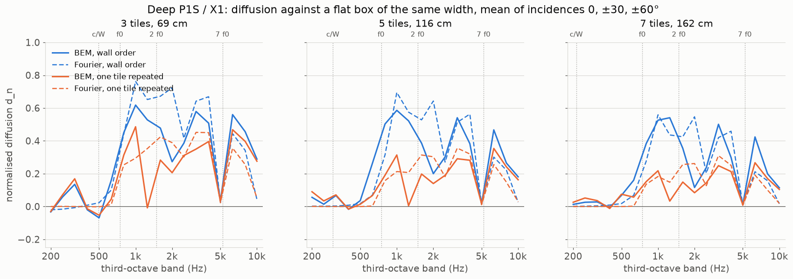
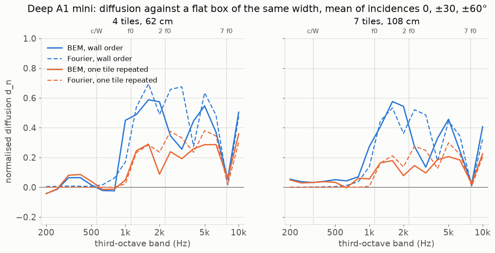
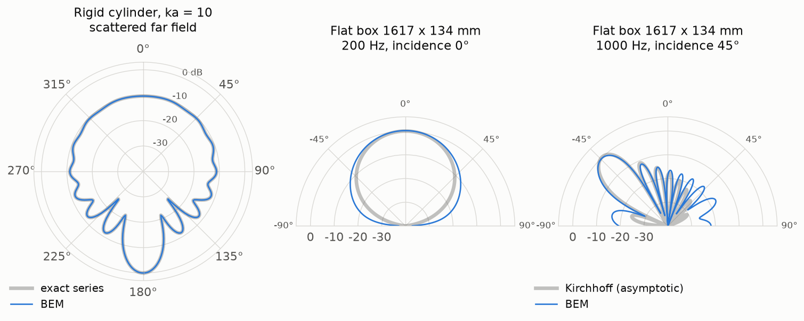
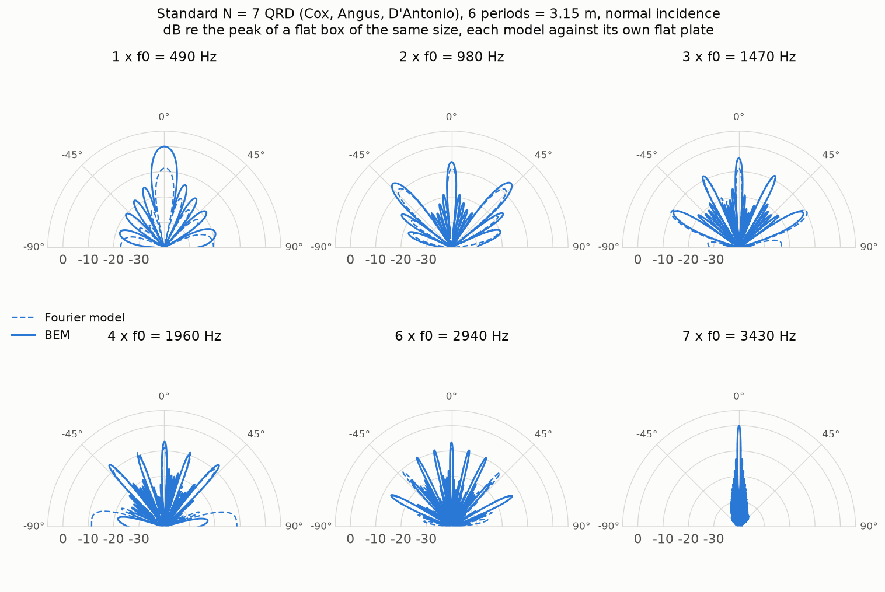
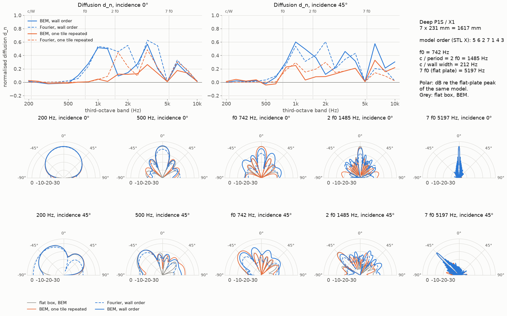
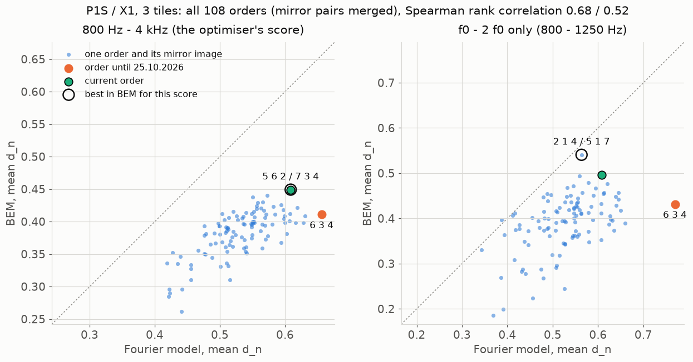
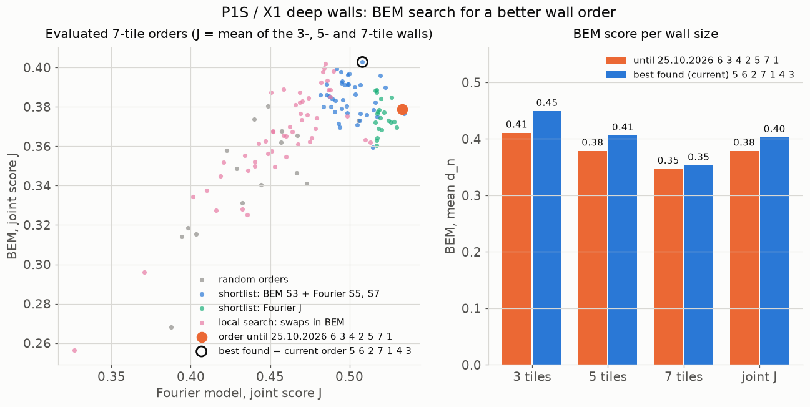
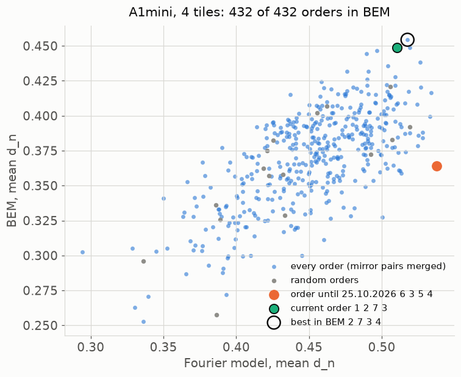
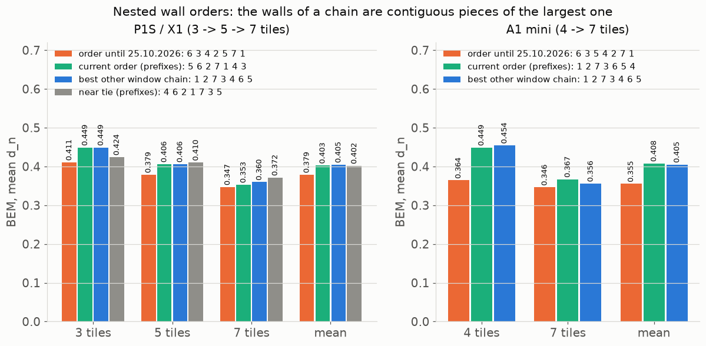

# 2D BEM check of the deep tiles

After the review on r/acoustics ("a pretty plot at 2 kHz says nothing about 200 Hz"; "without a measurement the band is
design intent") the deep tiles and walls were run through a 2D boundary element method (BEM) simulation and compared
with the Fourier model that picked the wall orders until 25.10.2026. BEM is what Cox and D'Antonio use to check
diffusers before a measurement. Everything here is a simulation, done on 24-25.10.2026 with AI assistance (Claude).
Nothing has been measured, and the numbers below are model predictions, not performance claims. The check changed the
wall orders of the generator: since 25.10.2026 the deep walls are built in an order chosen with BEM, and the results and
tables below are for that order. "Order until 25.10.2026" means the old one (P1S / X1 and MK4 / Core One
`6 3 4 2 5 7 1`, A1 mini `6 3 5 4 2 7 1`), "current order" the new one (P1S / X1 and MK4 / Core One
`5 6 2 7 1 4 3`, A1 mini `1 2 7 3 6 5 4`); all orders are in model (STL X) coordinates, as in `reference/layout.py`.
The code, the raw far fields and every figure are in [`checks/bem/`](../checks/bem/), so anyone can rerun it or point
out a mistake.

## Short answer

- Below f0 no wall diffuses. Between 200 Hz and f0 the normalised diffusion coefficient d_n is at most 0.10: the wall
  reflects like a flat panel of the same width. The reviewer was right about 200 Hz.
- The cyclic shifts work, but not from c / wall width. A wall in the current order starts to diffuse (d_n >= 0.3 in
  two third-octave bands in a row) at about f0: on the P1S / X1 in the 800 Hz band with 3, 5 and 7 tiles (f0 = 742
  Hz), on the A1 mini in the 1000 Hz band with 4 tiles and in the 1250 Hz band with 7 tiles (f0 = 1114 Hz). Between
  c / wall width and f0, d_n is 0.05-0.13.
- Between f0 and c / period (= 2 f0, a tile is λ0 / 2 wide) the order of the tiles makes a large difference: walls in
  the current order reach d_n 0.48-0.55, walls made of copies of one tile 0.13-0.26, and at normal incidence the
  copies hardly diffuse at all (0.02-0.14). It is the same physics as in the standard QRD below: a periodic surface has
  only one propagating reflection direction below c / period, the specular one.
- A single tile only diffuses from 2 f0 = c / tile width. The Fourier model says it diffuses from f0 (d_n about 0.8),
  BEM says it does not (0.07-0.21 on average, less than a flat panel at 45°).
- The Fourier model ranks things the same way as BEM: the current order beats copies of one tile in every range from f0
  up, and both models show the flat-plate frequency 7 f0. In numbers it is optimistic: it agrees with BEM within 0.06
  for 5 and 7 tiles and for the A1 mini walls between f0 and 2 f0, overestimates d_n of 3 P1S tiles there (0.62 against
  0.53), overestimates by 0.10-0.18 between 2 f0 and 7 f0 (by 0.20-0.30 at normal incidence) and underestimates above 7
  f0 at oblique incidence.
- The Fourier model chose the order until 25.10.2026, and BEM does not rate it the best. Of the 210 orders of a
  3-tile P1S / X1 wall, `6 3 4` was first in the Fourier model and 22nd of 108 mirror pairs in BEM (d_n 0.41); the BEM
  best `5 6 2` reaches 0.45. The two rankings correlate moderately (Spearman 0.68): the Fourier model is good at ruling
  out bad orders, not at picking the best one. On the A1 mini the order until 25.10.2026 for 4 tiles (`6 3 5 4`, first
  in the Fourier model) is 266th of all 432 in BEM, below the median.
- The orders in the generator were therefore replaced (25.10.2026) with ones from BEM rankings of the walls that exist:
  P1S / X1 `5 6 2 7 1 4 3` (3 / 5 / 7 tiles: d_n 0.45 / 0.41 / 0.35 against 0.41 / 0.38 / 0.35 before) and A1 mini
  `1 2 7 3 6 5 4` (4 / 7 tiles: 0.45 / 0.37 against 0.36 / 0.35). They are the best nested chains among the orders that
  BEM has run, 2-10 % of the classes at 5 and 7 tiles, so "best" means the best found, not the best possible.

What changed in the generator because of this: the order of the tiles in the deep walls (above), and earlier the lower
end of a deep wall's band. A deep wall narrower than 3.5 design wavelengths (fewer than 7 tiles at the default depth)
starts at √2 · f0 instead of f0, never below c / wall width (commit `ac8c5f2`, see "Band shown by the generator" in
[how-it-works.md](how-it-works.md)). A single tile starts at c / tile width = 2 f0, as before. The top of the band at
the flat-plate frequency 7 f0 (commit `2278725`) is what BEM shows as well. The √2 · f0 start was set with the order
until 25.10.2026; for the current order BEM starts diffusing earlier (see "Do the cyclic shifts make a wall diffuse"
below) and the rule has not been changed.





Solid lines BEM, dashed lines the Fourier model; blue the wall order (the current one), orange copies of tile 1. Shaded
bands: the flat reference itself already scatters almost evenly there (d_flat > 0.9), so d_n divides by almost zero.

## Method

Solver: [`checks/bem/bem2d.py`](../checks/bem/bem2d.py), about 200 lines of numpy and scipy. No ready tool fitted:
bempp-cl is 3D only, AcousticBEM is unmaintained and has no near-singular integration (a 1.6 mm fin has its other face
1.6 mm away), NiHu and OpenBEM need C++ or MATLAB.

- Exterior Helmholtz equation around a rigid (sound-hard) body, plane-wave incidence, far field.
- Burton-Miller formulation (CBIE plus i/k times the hypersingular equation), so the interior resonances of the closed
  body do not spoil the result. Without it the P1S reference box (231 x 134 mm) is 3.4 % off at its first interior
  resonance, 1480 Hz, and a 7-tile wall has such resonances all over the band.
- Constant elements on straight segments, collocation at the midpoints. The singular and near-singular parts of the
  Laplace kernels are integrated exactly over every segment, the smooth Helmholtz-minus-Laplace remainder by Gauss
  quadrature; the hypersingular operator in Maue's form.
- Element length at most min(λ / 10, 2 mm). The elements must be shorter than the fins are thick: a first run with
  λ / 8 capped at 8 mm was 13 % off in the diffusion coefficient of a P1S tile at f0.
- Geometry from `reference/diffuser.py`, rule v3: fins 1.6 mm, outer walls 2.0 mm (a 4.0 mm fin where two tiles meet),
  45° chamfers in the bottom corners of every well (3 mm A1 mini, 4 mm P1S), flat back. The closed air chambers under
  the shallow wells are invisible from outside.
- Wall orders: the `walls` of `reference/out/layouts.json` in model (STL X) coordinates, as in `reference/layout.py`:
  A1 mini class S (4 tiles `1 2 7 3`, 7 tiles `1 2 7 3 6 5 4`), P1S / X1 class L (3 `5 6 2`, 5 `5 6 2 7 1`, 7
  `5 6 2 7 1 4 3`). The walls grow by prefix. These are the current orders; the first runs (24.10.2026) used the
  order until 25.10.2026 (A1 mini 4 tiles `6 3 5 4`, 7 tiles `6 3 5 4 2 7 1`; P1S / X1 3 `6 3 4`, 5 `6 3 4 2 5`, 7
  `6 3 4 2 5 7 1`), and the order rankings below were made for it. Copies: tile 1 repeated, as in
  `layout.evaluate_deep`.
- Reference: a rigid box with the same outline (wall width x tile depth, wells filled), free-standing.
- Diffusion coefficient AES-4id / ISO 17497-2 over 37 receivers every 5°, energy averaged over the 6 frequencies of
  each third-octave band 200 Hz - 10 kHz (the same frequencies as the evaluation in `layout.py`), normalised per
  incidence: d_n = (d - d_flat) / (1 - d_flat). Incidences 0, ±30, ±45 and ±60°. `diffusion` and `band_energy` are
  imported from `layout.py`, and the Fourier model is called through its own code (`layout.Deep._tile`, `wall`,
  `flat`) on the same frequencies and receivers.
- Polar plots: dB re the peak of the flat reference of the same model at that frequency and incidence. Positive angles
  are on the +X side of the STL (seen from the room, STL X points left).

### What a rigid 2D BEM does not see

- 2D means infinitely long wells. A real tile is 155-231 mm along its wells, so in the plane along the wells it acts
  like a panel of that length. That is the usual assumption for 1D diffusers (single-plane measurement).
- Rigid walls: no viscous losses and no fin vibration. A real diffuser absorbs a little, mostly near the well
  resonances (deepest well a quarter wave at about 650 Hz on the P1S / X1, 975 Hz on the A1 mini) and in the narrow A1
  mini wells (20 mm, below the 25 mm minimum QRDude recommends). Where energy circulates between the wells, a real wall
  may reflect less than this BEM, not diffuse more.
- A free-standing sample, not one set into an infinite wall: that is how the diffusion coefficient against a flat panel
  of the same size is defined.

## Validation of the solver

[`checks/bem/validate.py`](../checks/bem/validate.py), numbers in `checks/bem/out/validation.json`.

| Test | Result |
|---|---|
| Rigid cylinder against the exact Bessel series (far field), ka = 1 / 10 / 30 | error 0.008 % / 0.11 % / 0.36 % |
| Cylinder at an interior resonance (ka = 2.405, zero of J0) | Burton-Miller 0.02 %, plain CBIE 0.12 % |
| P1S box 231 x 134 mm, 1440-1520 Hz (interior resonance 1479.6 Hz) | Burton-Miller at most 0.05 %, CBIE 3.4 % at 1480 Hz |
| Flat box 1617 x 134 mm against Kirchhoff, kW > 20 | specular peak within 0.2 dB, half main lobe within 0.1 dB (0°) and 1.1 dB (45°) |
| Flat box against Kirchhoff at small kW (one 231 mm tile, 200 Hz) | 0.4-5 dB apart: Kirchhoff does not hold there, as expected |
| Mesh: 2 mm elements and 4 Gauss points against 1 mm and 8 (tile, box, 7-tile P1S wall, f0 to 10 kHz) | diffusion coefficient within 0.004, levels above -20 dB within 0.4 dB |

A finite flat panel has no exact closed-form solution, so the cylinder is the strict test and Kirchhoff only an
asymptotic one (large kW, near the specular direction).



### Standard N = 7 QRD (Cox, Angus, D'Antonio, Proc. IOA 25(5), 2003)

f0 490 Hz, depth unit 50 mm (wells 0 50 200 100 100 200 50 mm), wells 75 mm, period 525 mm, fins 1.6 mm, 6 periods =
3.15 m, normal incidence. The energy of lobe q is taken between the half-way points to its neighbours and turned into
|R_q|² (BEM: divided by cos θ_q, because a lobe at an angle carries power ~ |R_q|² cos θ_q; the Fourier model has no
obliquity factor). Lobes at grazing (|sin θ| > 0.95) are left out.

| Frequency | Lobes | Spread of \|R_q\|², BEM | Spread, Fourier | Specular share, BEM / Fourier |
|---|---|---|---|---|
| f0 = 490 Hz | specular only (λ0 = 700 mm > period) | - | - | 100 % / 100 % |
| 2 f0 = 980 Hz | 3 | 3.7 dB | 0.4 dB | 18 % / 34 % |
| 3 f0 = 1470 Hz | 5 | 3.1 dB | 1.3 dB | 24 % / 23 % |
| 4 f0 = 1960 Hz | 5 | 4.8 dB | 1.3 dB | 22 % / 23 % |
| 5 f0 = 2450 Hz | 7 | 12.9 dB (lobes ±3 at 53° 10 dB weaker) | 2.7 dB | 25 % / 18 % |
| 6 f0 = 2940 Hz | 9 | 7.4 dB | 5.1 dB | 17 % / 16 % |
| 7 f0 = 3430 Hz (flat plate) | 9 | side lobes 19-29 dB below specular | 19-33 dB | 97 % / 97 % |

- The known properties hold: at 2-4 f0 the lobes carry similar energy (BEM between -3 and +1.7 dB around the mean, the
  Fourier model more even), and at 7 f0 the QRD reflects like a flat panel (97 % of the energy specular in both).
- From 5 f0 BEM moves away from equal lobes: a 73.4 mm well is wider than half a wavelength above
  c / (2 · 73.4 mm) = 2337 Hz, so cross modes propagate in the wells, which the plane-wave-in-a-well Fourier model does
  not know.
- The largest difference is at f0. The periodic QRD reflects exactly like a flat panel in BEM (peak -0.04 dB re the
  flat panel), while the Fourier model shows -8.6 dB. The Fourier model loses 7.9 dB of the total energy there: at f0
  the only real direction is the specular one (period 525 mm < λ0 700 mm), and the rest goes into evanescent waves that
  this model simply drops. In a lossless rigid body that energy does not vanish, it comes back in the specular
  direction (with real losses part of it becomes absorption). At 1.5 f0 (735 Hz): BEM -3.5 dB, Fourier -12.8 dB.



## Results for the tiles and walls

19 configurations (flat boxes of 1-7 tiles, tile 1, walls in the current order and of copies of tile 1), 113
frequencies each, 244-4947 elements. The first sweep (24.10.2026, order until 25.10.2026) took 11 minutes in 8
processes; after the orders changed, the five wall configurations were run again (565 solves, 5 minutes in 8
processes) and the other 14 kept (flat boxes, tile 1, copies of tile 1: they do not depend on the order). Raw far
fields: `checks/bem/out/raw/*.npz` (4 MB), numbers: `checks/bem/out/results.json`, tables below from
[`checks/bem/tables.py`](../checks/bem/tables.py). The means in these tables are over the third-octave bands of each
range with 6 frequencies per band, so they differ a little from the optimiser's score in the order sections below
(3 frequencies per band, 800 Hz - 4 kHz on the P1S / X1).

Ranges: c/W = c / wall width, c / period = 2 f0. "Wall order" is the current order. Means over the third-octave bands
whose centre lies in the range.
Bands where the flat reference itself scatters almost evenly (d_flat > 0.9: a small tile at 0.8-1.25 kHz) are left out.

#### A1 mini: f0 1114 Hz, 2 f0 = c / period 2227 Hz, 7 f0 7795 Hz

d_n, mean of incidences 0, ±30, ±60° (the optimiser's score), BEM / Fourier:

| Wall | c/W | below c/W | c/W - f0 | f0 - 2 f0 | 2 f0 - 7 f0 | 7 f0 band | above 7 f0 |
|---|---|---|---|---|---|---|---|
| 1 tile | 2227 Hz | -0.23 / 0.00 | - | 0.21 / 0.83 | 0.52 / 0.75 | 0.25 / 0.09 | 0.64 / 0.60 |
| 4 tiles, wall order | 557 Hz | 0.02 / 0.01 | 0.13 / 0.08 | 0.55 / 0.57 | 0.39 / 0.55 | 0.06 / 0.02 | 0.50 / 0.48 |
| 4 tiles, copies of tile 1 | 557 Hz | 0.03 / 0.00 | 0.01 / 0.01 | 0.21 / 0.25 | 0.25 / 0.33 | 0.06 / 0.02 | 0.36 / 0.30 |
| 7 tiles, wall order | 318 Hz | 0.04 / 0.00 | 0.10 / 0.04 | 0.51 / 0.45 | 0.29 / 0.39 | 0.02 / 0.01 | 0.41 / 0.33 |
| 7 tiles, copies of tile 1 | 318 Hz | 0.04 / 0.00 | 0.04 / 0.00 | 0.14 / 0.17 | 0.16 / 0.23 | 0.03 / 0.01 | 0.22 / 0.20 |

Lowest third-octave band with d_n >= 0.3 in two bands in a row, BEM / Fourier:

| Wall | c/W | mean of 0, ±30, ±60° | 0° | 45° | -45° |
|---|---|---|---|---|---|
| 1 tile | 2227 Hz | 2000 / 1250 | 1600 / 1600 | 1000 / 1000 | 1000 / 1000 |
| 4 tiles, wall order | 557 Hz | 1000 / 1250 | 1000 / 1250 | 1600 / 1250 | 1000 / 1250 |
| 4 tiles, copies of tile 1 | 557 Hz | never / 2500 | never / 2000 | never / 1250 | never / 1250 |
| 7 tiles, wall order | 318 Hz | 1250 / 1250 | 1600 / 1250 | 1250 / 1250 | 1250 / 1250 |
| 7 tiles, copies of tile 1 | 318 Hz | never / never | never / never | never / never | never / never |

One tile between f0 and 2 f0 (BEM / Fourier): 0° 0.68 / 0.96, 45° -0.19 / 0.79.

#### P1S / X1: f0 742 Hz, 2 f0 = c / period 1485 Hz, 7 f0 5197 Hz

d_n, mean of incidences 0, ±30, ±60° (the optimiser's score), BEM / Fourier:

| Wall | c/W | below c/W | c/W - f0 | f0 - 2 f0 | 2 f0 - 7 f0 | 7 f0 band | above 7 f0 |
|---|---|---|---|---|---|---|---|
| 1 tile | 1485 Hz | -0.12 / -0.05 | - | 0.07 / 0.78 | 0.49 / 0.75 | 0.13 / 0.09 | 0.59 / 0.41 |
| 3 tiles, wall order | 495 Hz | 0.04 / -0.01 | 0.05 / 0.06 | 0.53 / 0.62 | 0.44 / 0.62 | 0.03 / 0.02 | 0.44 / 0.28 |
| 3 tiles, copies of tile 1 | 495 Hz | 0.05 / 0.00 | 0.00 / 0.01 | 0.26 / 0.30 | 0.31 / 0.40 | 0.03 / 0.02 | 0.38 / 0.22 |
| 5 tiles, wall order | 297 Hz | 0.04 / 0.00 | 0.09 / 0.02 | 0.54 / 0.53 | 0.36 / 0.50 | 0.02 / 0.01 | 0.30 / 0.18 |
| 5 tiles, copies of tile 1 | 297 Hz | 0.06 / 0.00 | 0.03 / 0.00 | 0.17 / 0.19 | 0.22 / 0.29 | 0.02 / 0.01 | 0.25 / 0.14 |
| 7 tiles, wall order | 212 Hz | 0.01 / 0.00 | 0.06 / 0.02 | 0.48 / 0.42 | 0.30 / 0.41 | 0.01 / 0.01 | 0.25 / 0.13 |
| 7 tiles, copies of tile 1 | 212 Hz | 0.03 / 0.00 | 0.04 / 0.00 | 0.13 / 0.16 | 0.17 / 0.24 | 0.01 / 0.01 | 0.18 / 0.10 |

Lowest third-octave band with d_n >= 0.3 in two bands in a row, BEM / Fourier:

| Wall | c/W | mean of 0, ±30, ±60° | 0° | 45° | -45° |
|---|---|---|---|---|---|
| 1 tile | 1485 Hz | 1600 / 800 | 1250 / 1000 | 630 / 800 | 630 / 800 |
| 3 tiles, wall order | 495 Hz | 800 / 800 | 800 / 800 | 630 / 800 | 630 / 800 |
| 3 tiles, copies of tile 1 | 495 Hz | 800 / 1250 | never / 1250 | 800 / 800 | 800 / 800 |
| 5 tiles, wall order | 297 Hz | 800 / 800 | 800 / 800 | 800 / 800 | 630 / 800 |
| 5 tiles, copies of tile 1 | 297 Hz | never / 1600 | never / never | 800 / never | 800 / never |
| 7 tiles, wall order | 212 Hz | 800 / 1000 | 1000 / 1000 | 800 / 1000 | 800 / 1000 |
| 7 tiles, copies of tile 1 | 212 Hz | never / never | never / never | never / never | never / never |

One tile between f0 and 2 f0 (BEM / Fourier): 0° 0.50 / 0.89, 45° -0.23 / 0.77. At 45° the P1S tile has d_n >= 0.3
in the 630 and 800 Hz bands and then drops below zero at 1-1.25 kHz, so "630" in that row is not the start of steady
diffusion.

Every wall and the single tile have their own figure with d_n at 0° and 45° and polar plots at 200 Hz, 500 Hz, f0,
2 f0 and 7 f0: `checks/bem/out/fig-A1mini-tile.png`, `fig-A1mini-wall-4.png`, `fig-A1mini-wall-7.png`,
`fig-P1S-tile.png`, `fig-P1S-wall-3.png`, `fig-P1S-wall-5.png`, `fig-P1S-wall-7.png`. For example the widest wall:



## Where the Fourier model agrees with BEM, and where it does not

It agrees on:
- The ranking. A wall in the current order beats copies of one tile in BEM between f0 and 2 f0, between 2 f0 and 7 f0
  and above 7 f0, for every wall and both printers (for example P1S, 7 tiles, f0 - 2 f0: 0.48 against 0.13); in the
  7 f0 band both are a flat panel. The same holds in the Fourier model and held for the order until 25.10.2026, which
  that model picked. What it did not do was pick the best order among the orders of tiles (next sections).
- The 7 f0 band: d_n 0.01-0.06 for every wall in both models. This is the flat-plate frequency, and the band ends there.
- Below c / wall width, and between c / wall width and f0 for walls of 5-7 tiles: almost zero in both (BEM 0.06-0.10
  between c / wall width and f0, Fourier 0.02-0.04).
- 5- and 7-tile walls and the A1 mini between f0 and 2 f0: close means (P1S 5 tiles 0.54 / 0.53, 7 tiles 0.48 / 0.42,
  A1 mini 4 tiles 0.55 / 0.57, 7 tiles 0.51 / 0.45), band by band on the P1S within 0.11 in the optimiser's mean
  (0.18 at 45°).
- Polar plots at 7 f0: the same single specular lobe.

It does not agree on:
- Anything with the period of one tile below c / period (2 f0): the single tile and the copies. The Fourier model loses
  the energy of the evanescent waves there and shows a weaker specular reflection than a flat panel. Lossless BEM sends
  that energy back in the specular direction. P1S tile, f0 - 2 f0: BEM 0.07, Fourier 0.78. It is the same difference
  that gives -0.04 dB (BEM) against -8.6 dB (Fourier) for the standard QRD at f0.
- The smallest wall, 3 P1S tiles, between f0 and 2 f0: the Fourier model is too high (0.62 against 0.53). At 69 cm a few
  tiles are still almost one period.
- Between 2 f0 and 7 f0 the Fourier model is too high: walls in the current order by 0.10-0.18 on average and by
  0.20-0.30 at normal incidence (P1S, 7 tiles, 0°: BEM 0.26 against Fourier 0.48), copies by 0.07-0.09. BEM has deep
  dips just above c / period at normal incidence (P1S 7 tiles, 1.6-2 kHz: 0.09-0.14 against 0.46-0.55; A1 mini 7
  tiles, 2.5-3.15 kHz: 0.09-0.14 against 0.48-0.58).
- Above 7 f0 BEM gives more than the Fourier model at 45° (P1S, 7 tiles: 0.36 against 0.14) and less at 0° (A1 mini,
  7 tiles: 0.22 against 0.39). The wells are wider than half a wavelength there, and a model with a plane wave in each
  well does not see the cross modes.
- The Fourier model has no obliquity factor (cos θ), which puts too much energy at wide receiver angles.

## Do the cyclic shifts make a wall diffuse from c / wall width?

Not from c / wall width, but from about f0, and only for wider walls.

- Between c / wall width and f0 a wall in the current order has d_n 0.05-0.13 in BEM, copies 0.00-0.04. There is a
  difference, but the wall still reflects like a panel. The phase differences between the wells are too small to
  spread the reflection (both models give almost zero for walls of 5-7 tiles), so the shifts have nothing to rearrange.
- Between f0 and 2 f0, where one tile and copies of one tile reflect specularly, a wall of cyclic shifts really
  diffuses (BEM 0.48-0.55). That is what the shifts buy: without them this octave would be lost, because the tile
  period (λ0 / 2) is too short for grating lobes at f0.
- Start of diffusion (the mean of 0, ±30, ±60°): P1S, 3, 5 and 7 tiles (69, 116 and 162 cm) from the 800 Hz band; A1
  mini, 4 tiles (62 cm) from 1000 Hz, 7 tiles (108 cm) from 1250 Hz. The Fourier model gave the same band for the 3- and
  5-tile P1S walls, one band higher for 7 tiles (1000 Hz) and 1250 Hz for both A1 mini walls.

How the start moved when the order changed (BEM, the same bands, the same rule):

| Wall | Order until 25.10.2026 | Current order | Generator starts at |
|---|---|---|---|
| P1S / X1, 3 tiles | 1000 Hz | 800 Hz | √2 · f0 = 1050 Hz |
| P1S / X1, 5 tiles | 1000 Hz | 800 Hz | 1050 Hz |
| P1S / X1, 7 tiles | 800 Hz | 800 Hz | f0 = 742 Hz |
| A1 mini, 4 tiles | 1600 Hz | 1000 Hz | √2 · f0 = 1575 Hz |
| A1 mini, 7 tiles | 1000 Hz | 1250 Hz | f0 = 1114 Hz |

The generator's √2 · f0 start for deep walls narrower than 3.5 design wavelengths comes from the first column: √2 · f0
was 1050 Hz and 1575 Hz next to the 1000 Hz and 1600 Hz bands found for the order until 25.10.2026. With the current
order the small walls reach d_n 0.3 one third of an octave (P1S) to two thirds of an octave (A1 mini) earlier, about
where f0 is, so the √2 · f0 start is now on the cautious side. The 7-tile A1 mini wall moved the other way, by one
band, to the 1250 Hz band, whose lower edge (1114 Hz) is f0 itself. The rule in the generator was not changed with the
order.

## Every order of a 3-tile P1S / X1 wall

[`checks/bem/order_ranking.py`](../checks/bem/order_ranking.py) scores all 7 · 6 · 5 = 210 orders of three P1S / X1
tiles with the optimiser's own score: mean d_n over the incidences 0, ±30 and ±60° and the third-octave bands from f0
to below 7 f0 (800 Hz - 4 kHz), 3 frequencies per band, against the flat box of the same width. A tile turned upside
down is tile 9 - t (tile 1 stays), so the order a b c in a mirror is m(c) m(b) m(a), the same wall mirrored, with the
same score; BEM ran one order of every mirror pair (108 pairs) plus both sides of three pairs, which agree to five
decimals. The Fourier model ran all 210. About 8 minutes in 8 processes. Summary: `checks/bem/out/ranking-P1S-3.json`,
band energies of every BEM run: `checks/bem/out/ranking-P1S-3-bem.jsonl`. The ranking was made for the order until
25.10.2026 (`6 3 4` as the 3-tile wall); the script keeps that order and the current one (`5 6 2`) as named
constants, so its numbers do not depend on what `layouts.json` says, and `--cache-only` rebuilds the summary and the
figure from the band energies without BEM.

| | BEM | Fourier |
|---|---|---|
| Score of all orders (min / median / max) | 0.26 / 0.39 / 0.45 | 0.42 / 0.54 / 0.66 |
| Order until 25.10.2026 `6 3 4` (mirror `5 6 3`) | 0.41, rank 22 of 108 | 0.66, rank 1 |
| Current order `5 6 2` (mirror `7 3 4`), the BEM best | 0.45, rank 1 | 0.61, rank 6 |
| Between f0 and 2 f0 only (800-1250 Hz): order until 25.10.2026 | 0.43, rank 28 | 0.77, rank 1 (next best 0.66) |
| Between f0 and 2 f0 only: current order | 0.50, rank 2 | 0.61, rank 16 |
| Between f0 and 2 f0 only: best order | `2 1 4` (mirror `5 1 7`), 0.54 | `6 3 4`, 0.77 |

- The rankings agree moderately: Spearman rank correlation 0.68 (Kendall 0.49) over the whole score, 0.52 between f0
  and 2 f0. Only 2 of the BEM top 10 are in the Fourier top 10. Both models put the same orders at the bottom
  (`1 2 3`, `3 4 5` and `2 1 7` are the last three in BEM and between 101st and 107th in the Fourier model).
- The order until 25.10.2026 is a good one: in the top fifth in BEM, 0.15 above the worst order and 0.04 below the best.
  It is not the best, and the reason is visible in the right half of the figure: between f0 and 2 f0 the Fourier model
  rates it far above every other order (0.77, the next one 0.66), while BEM puts it 28th. The optimiser picked the
  order where the Fourier model is most wrong in the range where it is least reliable.
- The difference to the BEM best (0.04 in d_n) is ten times the mesh error of the solver (0.004) but small against what
  a rigid 2D model leaves out (losses, the finite tile length).
- What it means for the generator: the Fourier model is fine for ruling out bad orders and a poor judge among the good
  ones. A better order has to come from BEM, for example on a Fourier shortlist, which is what the next sections do.
  The 5- and 7-tile walls were not ranked here (2520 and 5040 orders at about 1.5 and 2.5 minutes each in one process,
  so about 4 and 14 hours in 8 processes even with mirror pairs merged).



Each dot is one order and its mirror image; orange the order until 25.10.2026, green the current order,
which is also the best order in BEM for the score of the left panel (the ring in the right panel is the best between
f0 and 2 f0).

## A BEM search over the 3-, 5- and 7-tile walls together (P1S / X1)

A wall grows by prefix: 3 tiles are the first three of the order, 5 tiles the first five, 7 tiles all of it. So a
different order has to be judged on all three walls at once, with the optimiser's joint score J = (S3 + S5 + S7) / 3.
[`checks/bem/order_search.py`](../checks/bem/order_search.py) searched for a better 7-tile order in BEM, against the
order until 25.10.2026 (kept in the script as a named constant; `--cache-only` replays the search from the cached band
energies):

- The Fourier model scored all 5040 orders. On the v3 P1S / X1 geometry the order until 25.10.2026 `6 3 4 2 5 7 1` is
  2nd (it was optimised on the stage 1 size), next to `6 3 4 2 5 1 7`.
- Round 1 ran a shortlist in BEM: the top 40 by a hybrid predictor (the exact BEM S3 of the 3-tile ranking plus Fourier
  S5 and S7 mapped onto the BEM scale), the top 25 by the Fourier J, the order until 25.10.2026 and 16 random orders.
- Round 2 tried every swap of two tiles in the 3 best orders. None was better than the best of round 1, so the search
  stopped there.
- 128 orders with all three walls in BEM, 226 new BEM runs, 70 minutes in 12 processes. Summary
  `checks/bem/out/search-P1S.json`, band energies of every run `checks/bem/out/search-P1S-bem.jsonl`.

| BEM, mean d_n | 3 tiles | 5 tiles | 7 tiles | joint J |
|---|---|---|---|---|
| Order until 25.10.2026 `6 3 4 2 5 7 1` | 0.41 | 0.38 | 0.35 | 0.379 |
| Best found `5 6 2 7 1 4 3` (the current order) | 0.45 | 0.41 | 0.35 | 0.403 |
| 16 random orders (min - max) | | | 0.29 - 0.35 | 0.27 - 0.38 |
| Best 7-tile wall found (`4 6 2 1 7 3 5`) | 0.42 | 0.41 | 0.37 | 0.402 |

| Best found against order until 25.10.2026, BEM | 3 tiles | 5 tiles | 7 tiles |
|---|---|---|---|
| f0 - 2 f0 (800-1250 Hz) | 0.50 / 0.43 | 0.52 / 0.41 | 0.45 / 0.44 |
| 2 f0 - 7 f0 (1.6-4 kHz) | 0.42 / 0.40 | 0.34 / 0.36 | 0.30 / 0.29 |
| Normal incidence | 0.44 / 0.38 | 0.39 / 0.35 | 0.31 / 0.28 |

- The order until 25.10.2026 is good: better than 15 of the 16 random orders. The best order found is better at every
  wall size, by 0.04 at 3 tiles, 0.03 at 5 tiles and 0.006 at 7 tiles (the solver's mesh error is 0.004). The gain is
  between f0 and 2 f0; between 2 f0 and 7 f0 the 5-tile wall is a little worse.
- For the 7-tile wall the order hardly matters: random orders score 0.29-0.35, the old one 0.35 and the best 7-tile wall
  found 0.37.
- The Fourier model would not have found it: the best order is 83rd of 5040 there, and the best order of the Fourier
  shortlist is 25th in BEM. Of the BEM top 5, two came from the hybrid shortlist, three from the swaps and none from
  the Fourier shortlist. On the 16 random orders the Spearman rank correlation of Fourier and BEM is 0.82 for 5 tiles,
  0.45 for 7 tiles and 0.66 for J (a small sample).
- The order was found for one geometry only (P1S / X1 at the default depth), while the same order also serves the
  MK4 / Core One and other depths. This best order is the P1S / X1 order of the generator since 25.10.2026; the section
  on nested walls below compares it with the alternatives.



## Rankings per wall: P1S / X1 with 5 and 7 tiles, A1 mini with 4 and 7 tiles

[`checks/bem/order_walls.py`](../checks/bem/order_walls.py) ranks the orders of one wall at a time with the same score
(mean d_n over 0, ±30, ±60°, bands from f0 to below 7 f0: P1S / X1 800 Hz - 4 kHz, A1 mini 1 - 6.3 kHz, 3 frequencies
per band, against the flat box of the same width), one order per mirror class. What BEM ran: for the A1 mini 4-tile wall
all 432 mirror classes (840 orders); for the 5- and 7-tile walls the Fourier top 40 classes, both the old and the
current order, 16 random classes (the only unbiased sample for the rank correlation) and every class already run in the
search above, so the rank of an order is among the evaluated ones only. Band energies of every run:
`checks/bem/out/walls-P1S-bem.jsonl` and `walls-A1mini-bem.jsonl`, summary `checks/bem/out/walls.json`, one figure per
wall `fig-walls-*.png`. The rankings were made on the night of 25.10.2026 for the order until 25.10.2026, which the
script keeps as a constant next to the current one.

| Wall | BEM ran | Order until 25.10.2026: rank, d_n | Current order: rank, d_n | Best found, d_n |
|---|---|---|---|---|
| P1S / X1, 5 tiles | 129 of 1272 classes | `6 3 4 2 5`: 58th, 0.379 | `5 6 2 7 1`: 7th, 0.406 | `2 7 4 6 5`: 0.421 |
| P1S / X1, 7 tiles | 145 of 2544 | `6 3 4 2 5 7 1`: 36th, 0.347 | `5 6 2 7 1 4 3`: 22nd, 0.353 | `1 2 7 3 6 5 4`: 0.372 |
| A1 mini, 4 tiles | all 432 | `6 3 5 4`: 266th, 0.364 | `1 2 7 3`: 2nd, 0.449 | `2 7 3 4`: 0.454 |
| A1 mini, 7 tiles | 56 of 2544 | `6 3 5 4 2 7 1`: 11th, 0.346 | `1 2 7 3 6 5 4`: 1st, 0.367 | the current order |

Against 16 random orders: P1S 5 tiles 0.22-0.40, P1S 7 tiles 0.29-0.35, A1 mini 4 tiles 0.26-0.42, A1 mini 7 tiles
0.28-0.34. All 432 classes of the A1 mini 4-tile wall: 0.25 / median 0.38 / 0.45. The solver's mesh error is 0.004.

- P1S / X1: the 5- and 7-tile walls of the order until 25.10.2026 were good (better than almost all random orders) but
  not the best. The gain of a good order is almost all between f0 and 2 f0 (5 tiles: +0.11 for the best found, +0.001
  above 2 f0). The current 5-tile wall is 7th of the 129 evaluated, 0.027 above the old one (+0.108 between f0 and 2 f0,
  -0.021 between 2 f0 and 7 f0); the current 7-tile wall is 0.006 above the old one, which is hardly more than the mesh
  error.
- A1 mini, 4 tiles (the ranking is complete): the order until 25.10.2026 `6 3 5 4` was first in the Fourier model and
  is 266th of 432 in BEM, below the median (0.364 against 0.375). It is the same trap as for the 3-tile P1S wall: the
  optimiser chose the order that the Fourier model overrates most. The current `1 2 7 3` is 2nd, 0.449, +0.085 (+0.13
  between f0 and 2 f0); the best, `2 7 3 4`, is 0.005 higher, about one mesh error.
- A1 mini, 7 tiles: the old order is 11th of the 56 evaluated and better than all random ones; the current one is the
  best of the 56 (+0.021).
- The Fourier model orders random samples well for 4-5 tiles (Spearman 0.79-0.82) and poorly for 7 (0.45-0.53), and
  its shortlist is a minimum, not a guarantee: in the complete A1 mini 4-tile ranking the five best orders sit at places
  13-90 of the Fourier ranking.



## Which order does the generator use? Nested walls

A wall grows when tiles are added, and tiles already stuck on do not move, so each smaller wall must be a contiguous
piece of the next larger one. [`checks/bem/order_nested.py`](../checks/bem/order_nested.py) ranks such chains from every
BEM run in the repository (no new simulation for this part), by the mean of the wall scores of the chain (the
optimiser's score as above), in two ways: prefix chains (3 tiles = the first three of the order, 5 = the first five, 7 =
all; how the generator grows a wall) and window chains (each smaller wall any contiguous window of the larger one, both
orientations tried). Only chains whose walls were all run in BEM count: for the P1S 145 orders of 7 tiles (135 prefix
chains, 138 window chains), for the A1 mini 56. Summary `checks/bem/out/nested.json`, figure `fig-nested.png`.

| BEM, mean d_n of the chain | Walls | 3 tiles | 5 tiles | 7 tiles | Mean |
|---|---|---|---|---|---|
| P1S / X1, order until 25.10.2026 | `6 3 4` ⊂ `6 3 4 2 5` ⊂ `6 3 4 2 5 7 1` | 0.411 | 0.379 | 0.347 | 0.379 (58th of 135) |
| P1S / X1, current order | `5 6 2` ⊂ `5 6 2 7 1` ⊂ `5 6 2 7 1 4 3` | 0.449 | 0.406 | 0.353 | 0.403 (1st of 135) |
| P1S / X1, near tie | `4 6 2` ⊂ `4 6 2 1 7` ⊂ `4 6 2 1 7 3 5` | 0.424 | 0.410 | 0.372 | 0.402 |
| P1S / X1, best window chain | `7 3 4` ⊂ `1 2 7 3 4` ⊂ `1 2 7 3 4 6 5` | 0.449 | 0.406 | 0.360 | 0.405 |

| BEM, mean d_n of the chain | Walls | 4 tiles | 7 tiles | Mean |
|---|---|---|---|---|
| A1 mini, order until 25.10.2026 | `6 3 5 4` ⊂ `6 3 5 4 2 7 1` | 0.364 | 0.346 | 0.355 (8th of 56) |
| A1 mini, current order | `1 2 7 3` ⊂ `1 2 7 3 6 5 4` | 0.449 | 0.367 | 0.408 (1st of 56) |
| A1 mini, best other window chain | `2 7 3 4` ⊂ `1 2 7 3 4 6 5` | 0.454 | 0.356 | 0.405 |

- The current orders are the best prefix chains among those BEM has run, on both series: P1S / X1 0.403 against 0.379
  for the order until 25.10.2026, better at every wall size; A1 mini 0.408 against 0.355. By wall: P1S 3 tiles +0.038,
  5 tiles +0.027, 7 tiles +0.006; A1 mini 4 tiles +0.085, 7 tiles +0.021.
- P1S / X1, near tie: `4 6 2 1 7 3 5` has the same mean (0.402 against 0.403, well under the mesh error 0.004), a
  better 7-tile wall (+0.019) and a worse 3-tile wall (-0.025). The current order is the one with the better smallest
  wall.
- P1S / X1, window chain: the best chain overall lets the wall grow on both sides, and its 3- and 5-tile walls are the
  mirror images of the current ones (`7 3 4` is `5 6 2` seen in the mirror, `1 2 7 3 4` is `5 6 2 7 1`), so they score
  the same. Only the 7-tile wall differs: the pair `6 5` is added on the other side of the 5-tile wall, 0.360 against
  0.353 (+0.007, under two mesh errors). It would need a wall that grows to the left from 3 to 5 tiles and to the right
  from 5 to 7, not by prefix, so it was not taken.
- A1 mini: the current chain is also the best window chain. The best 4-tile wall of all 432 (`2 7 3 4`, 0.454) leads
  to a worse 7-tile wall in this cache (0.356).

Which way the wall list goes. The generator lists tiles as seen from the room (`room_left_to_right`), while the model,
the STL and all numbers here are in STL X order, tile `order[0]` at x = 0. The check in `order_nested.py` reads
`reference/out/layouts.json`: the walls are prefixes of `order` and `room_left_to_right` is the reverse of each wall;
the cached score of every wall equals the numbers above; and a fresh BEM run of the smallest wall of each class, built
from `room_left_to_right` reversed back into model order, gives the cached number: P1S / X1 3 tiles (room `2 6 5`, model
`5 6 2`) 0.4492 fresh against 0.4492 cached, A1 mini 4 tiles (room `3 7 2 1`, model `1 2 7 3`) 0.4490 against 0.4490.
The same tiles read in room order without reversing are different walls and score 0.4168 and 0.4092. (Turning a whole
wall around, with every tile upside down, gives the same score, but a list read in the wrong direction does not.)

What this does not show:

- BEM ran only part of the orders: all 432 for the A1 mini 4-tile wall, but 10 % of the P1S 5-tile classes, 5.7 % of
  the P1S 7-tile classes and 2.2 % of the A1 mini 7-tile classes. "Best" means best among the orders run, and the
  chains above only exist for the 145 and 56 orders of 7 tiles in the cache. A better chain may exist.
- Local swaps around the A1 mini candidate were not run (the P1S search did them: none of the swaps of the 3 best
  orders was better).
- A rigid 2D BEM without losses, one geometry per size at the default depth. The series L order also serves the MK4 /
  Core One, series S only the A1 mini. Gains of a few thousandths (7 tiles) are within the mesh error; 0.03-0.09 at 3-5
  tiles are not.
- Nothing here is a measurement.



## Still open

- A measured comparison of the current order, the order until 25.10.2026 and copies of one tile.
- The 5- and 7-tile orders were searched in BEM only partly (2-10 % of the classes), and the local swaps of the A1 mini
  candidate were not run. A search of more orders, or a different growth rule for the walls, may find better ones.
- The band start of the generator (√2 · f0 for deep walls narrower than 3.5 design wavelengths) was fitted to the order
  until 25.10.2026; for the current order BEM starts earlier (see above) and the rule is unchanged.
- Block tiles were not simulated (they need 3D BEM).
- A measurement is still the only proof. What to look for: the specular reflection of a wall in the current order
  dropping from about f0, no such drop for copies at normal incidence, the specular reflection coming back at 7 f0
  (P1S 5.2 kHz, A1 mini 7.8 kHz).

## Running it

Python 3.11 or newer with `pip install -r checks/bem/requirements.txt` (numpy, scipy, matplotlib), from the repository
root:

```
python checks/bem/validate.py     # solver checks, about 5 minutes -> out/validation.json, fig-validation-*.png
python checks/bem/sweep.py        # the BEM runs, about 11 minutes with 8 processes -> out/raw/*.npz
python checks/bem/analysis.py     # diffusion coefficients and figures -> out/results.json, fig-*.png
python checks/bem/tables.py       # the tables of this page
python checks/bem/order_ranking.py   # all orders of a 3-tile P1S wall, about 8 minutes -> out/ranking-P1S-3.*
python checks/bem/order_search.py    # better 7-tile P1S orders, about 70 minutes in 12 processes -> out/search-P1S.*
python checks/bem/order_walls.py     # per-wall rankings (P1S 5 and 7, A1 mini 4 and 7 tiles) -> out/walls.json
python checks/bem/order_nested.py    # nested chains and the check of layouts.json -> out/nested.json
```

`sweep.py` skips configurations that already have a raw file, so delete `checks/bem/out/raw/` to run everything again,
or only the five wall files (`P1S-wall-3, -5, -7`, `A1mini-wall-4, -7`) after the orders in `layouts.json` change.
The four order scripts keep the order until 25.10.2026 as a constant, and the band energies of their BEM runs are in
the repository (`checks/bem/out/*-bem.jsonl`, 9 MB), so `order_ranking.py`, `order_search.py` and `order_walls.py` with
`--cache-only` rebuild their summaries and figures in seconds without any BEM (the commands above without the flag
rerun the BEM runs that are missing from the files, which is the long part), and `order_nested.py --no-bem` skips the
five fresh BEM runs (35 seconds in 6 processes).

## References

- T. J. Cox, P. D'Antonio, *Acoustic Absorbers and Diffusers: Theory, Design and Application*, 3rd ed., CRC Press, 2016
  (chapters on Schroeder diffusers and on prediction models).
- T. J. Cox, J. A. S. Angus, P. D'Antonio, "The performance of Schroeder diffusers: a wide band BEM investigation",
  Proc. IOA 25(5), 2003 (the standard N = 7 QRD).
- A. J. Burton, G. F. Miller, "The application of integral equation methods to the numerical solution of some exterior
  boundary-value problems", Proc. R. Soc. Lond. A 323, 1971, 201-210.
- AES-4id-2001 and ISO 17497-2:2012 for the diffusion coefficient.
